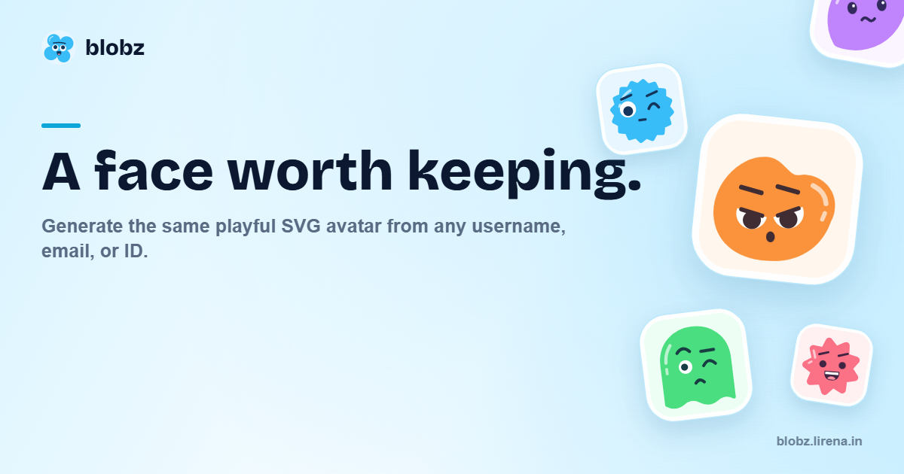

# Blobz

**Give any name, username, or ID a face that stays the same.** Blobz turns a string into a playful SVG avatar. The same input and palette produce the same character, so your app can render it again without storing an image or calling a service.

Blobz includes a **shadcn/ui registry** of avatar components and blocks, plus standalone React and TypeScript libraries. The registry components and libraries are **free and MIT-licensed**. An optional **paid hosted image API** is available separately; local rendering and registry components require no account, API key, or subscription.

[](https://www.npmjs.com/package/@blobz/avatar-core)
[](https://www.npmjs.com/package/@blobz/react)
[](./LICENSE)

[Browse shadcn components](https://blobz.lirena.in/docs/components) · [Try the avatar studio](https://blobz.lirena.in/create) · [Read the docs](https://blobz.lirena.in/docs) · [See the packages](#pick-your-way-in)

## Pick your way in

| You want to… | Use |
| --- | --- |
| Add avatars and blocks to a shadcn/ui project | [Public `@blobz` registry](https://blobz.lirena.in/docs/components) |
| Put avatars in a React app | [`@blobz/react`](https://www.npmjs.com/package/@blobz/react) |
| Generate SVG without React | [`@blobz/avatar-core`](https://www.npmjs.com/package/@blobz/avatar-core) |
| Design a face by hand | [Avatar studio](https://blobz.lirena.in/create) or `CustomAvatar` from `@blobz/react/custom` |
| Serve avatar images by URL | [Paid hosted API](./docs/hosted-api.md) |

### shadcn registry

In an existing shadcn project, install the Avatar component directly:

```bash
npx shadcn@latest add @blobz/avatar
```

The CLI copies the source into your configured shadcn UI directory and installs its dependencies and status color variables. The Avatar uses Base UI primitives, Tailwind theme tokens, and the familiar shadcn composition API. Its generated fallback renders locally through `@blobz/react`:

```tsx
import { Avatar, AvatarFallback } from "@/components/ui/avatar";

export function ProfileAvatar() {
  return (
    <Avatar>
      <AvatarFallback name="janaki-ammal" alt="Janaki's avatar" />
    </Avatar>
  );
}
```

Add an `AvatarImage` inside the same `Avatar` to display an image URL; the generated face appears while the image loads, if it fails, or when no image is supplied. Status badges, unread counts, and avatar groups come from the same module. Profile cards, testimonial cards, person selectors, account menus, team lists, chat panels, and user tables compose these shared primitives with shadcn components.

Verify the integration through the [`@blobz` entry in shadcn's public registry index](https://ui.shadcn.com/r/registries.json), the [published Avatar registry item](https://blobz.lirena.in/r/avatar.json), the [registry manifest](./registry.json), and the [Avatar source](./packages/ui/src/components/avatar.tsx). The [component and block definitions](./apps/web/src/registry/blobz) show the other installable items and their shadcn dependencies.

The standalone npm libraries below also work in projects that do not use shadcn/ui.

### React: one component

```bash
bun add @blobz/react
```

```tsx
import { Avatar } from "@blobz/react";

export function ProfileAvatar() {
  return (
    <Avatar
      name="janaki-ammal"
      alt="Janaki's avatar"
      palette={["#f2f1f4", "#7c6cf2"]}
      frame="rounded"
      size={64}
    />
  );
}
```

### Anywhere else: SVG as a string

```bash
bun add @blobz/avatar-core
```

```ts
import { createAvatar } from "@blobz/avatar-core";

const { svg, choices } = createAvatar({
  name: "janaki-ammal",
  palette: ["#f2f1f4", "#7c6cf2"],
  frame: "rounded",
});

// svg is the complete image; choices describes the generated face.
```

The name selects the face. The palette colors it; the frame chooses its crop. Blobz hashes the normalized input into stable feature choices and renders those choices as SVG. There is no random seed to save and no image asset to upload. If you want to pick every feature yourself, use [`createCustomAvatar`](./packages/avatar-core/README.md#build-a-face-manually) or [`CustomAvatar`](./packages/react/README.md#custom-faces).

## What's in this repo

| Path | Role | Main tools |
| --- | --- | --- |
| [`packages/avatar-core`](./packages/avatar-core) | Deterministic avatar generator and SVG renderer | TypeScript, tsup |
| [`packages/react`](./packages/react) | React image components built on the core | React 19, TypeScript |
| [`apps/web/src/registry/blobz`](./apps/web/src/registry/blobz) | Installable avatar compositions, cards, and blocks | shadcn/ui registry, Tailwind CSS |
| [`apps/web`](./apps/web) | Studio, docs, account dashboard, and hosted image API | Next.js 16, Tailwind CSS, Fumadocs |
| [`packages/db`](./packages/db) | Account, billing, and usage data | Drizzle ORM, Neon Postgres |
| [`packages/auth`](./packages/auth) | Google sign-in and account sessions | Better Auth |
| [`packages/ui`](./packages/ui) | Registry Avatar primitives, shared components, and styles | shadcn/ui, Base UI |

Dodo Payments handles subscriptions for the optional paid hosted API. Varlock validates server configuration; Bun and Turborepo run the workspace. The avatar libraries and installed registry components work without the web app, database, or billing setup.

## Run the site locally

```bash
bun install
bun run dev:web
```

The site runs at `http://localhost:3001`. The studio and docs are available without an account. Dashboard and hosted API work need the services listed in [`apps/web/.env.schema`](./apps/web/.env.schema); [CONTRIBUTING.md](./CONTRIBUTING.md) has the local setup and checks. The [hosted API guide](./docs/hosted-api.md) covers image URLs, origin rules, quotas, and billing operations.

## License

MIT. See [LICENSE](./LICENSE). The published packages include their own license copies.
